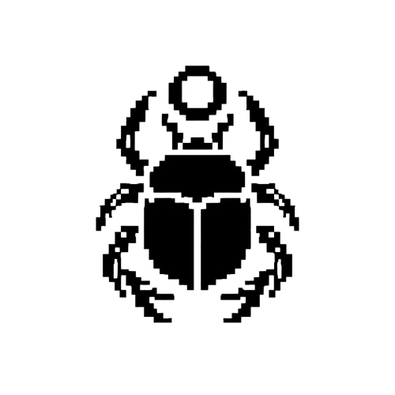
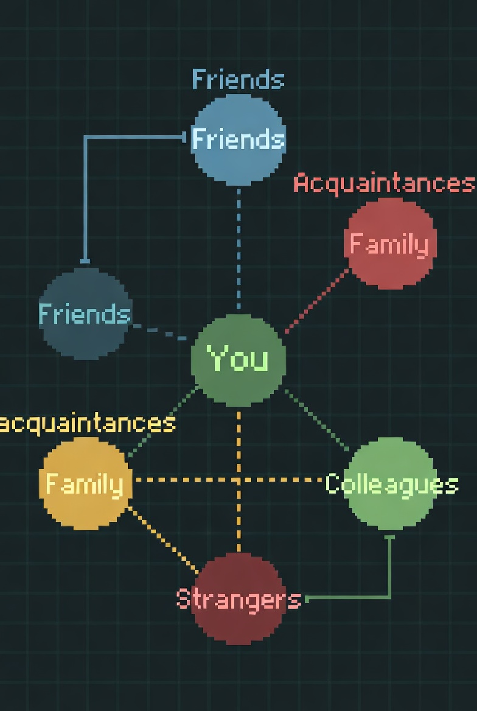
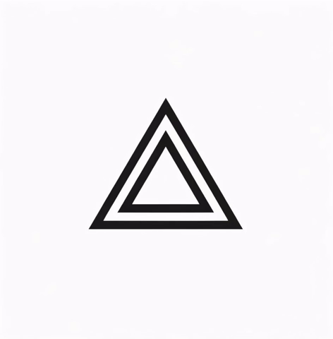
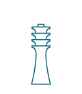

# **Welcome to .me**
> **Go Algorithmic.**

<table>
<tr>
<td valign="middle" align="center" width="240">
<picture>
  <source media="(prefers-color-scheme: dark)" srcset="./assets/beatle.me.png">
  
</picture>
</td>
<td valign="middle" align="center" width="420">

</td>
</tr>
</table>

<h2>me.whatever(what)</h2>

<em>“set what to 8 and let whatever follow what times two plus one”</em>

<small><a href="https://neurons-me.github.io/.me/docs/Syntax.html">.me syntax</a> · <a href="https://neurons-me.github.io/.me/docs/Operators.html">operators</a> · <a href="https://neurons-me.github.io/.me/docs/Explain.html">me.explain()</a></small>

<table>
  <tr>
    <th colspan="3" align="left">
      <h2>DEMOS</h2>
    </th>
  </tr>
<tr>
<td width="33%" valign="top" align="center">

<h3>Context-Aware Robots</h3>
The same object changes meaning depending on who, where, and why..  
<a href="https://neurons-me.github.io/.me/docs/Robots-That-Understand-Context.html"><kbd>Learn more →</kbd></a>
</td>
<td width="33%" valign="top" align="center">

<h3>Smart Cities</h3>

Living infrastructure coordinated through reactive knowledge graphs.
<a href="https://neurons-me.github.io/smart-cities/" target="_blank"><kbd>Learn more →</kbd></a>
</td>
<td width="33%" valign="top" align="center">

<h3>Social Networks</h3>

Explainable relationship networks built on human connection.  
<a href="https://neurons-me.github.io/.me/docs/Social-Graph.html" target="_blank"><kbd>Learn more →</kbd></a>
</td>
</tr>
<tr>
<td width="33%" valign="top" align="center">

<h3>Encrypted Audience Algebra</h3>

Who can see what, derived — not declared. Audience as algebra over secret scopes.  
<a href="https://neurons-me.github.io/.me/Typescript/typedocs/Algebra-of-Contexts.html" target="_blank"><kbd>Learn more →</kbd></a>
</td>
<td width="33%" valign="top" align="center">

<h3>Wallet Split</h3>

Two friends share a trip wallet — split logic derived automatically from raw contributions.  
<a href="https://neurons-me.github.io/.me/Typescript/typedocs/examples/WalletSplit.html" target="_blank"><kbd>Learn more →</kbd></a>
</td>
<td width="33%" valign="top" align="center">

<h4>Affinity Model</h4>

Affinity is emergent — store reactions, derive affinity as executable graph logic.  
<a href="https://neurons-me.github.io/.me/Typescript/typedocs/examples/Affinity-Model.html" target="_blank"><kbd>Learn more →</kbd></a>
</td>
</tr>
</table>

## Benchmarks

<table>
<tr>
<td width="33%" valign="top" align="center">
<h3><a href="https://github.com/neurons-me/.me/tree/main/Typescript/tests/Phases" target="_blank">Phase 2 · Disk & Write Pressure</a></h3>

Incremental disk persistence, explain-lookup latency, sustained write/rewrite pressure on the kernel.
</td>
<td width="33%" valign="top" align="center">
<h3><a href="https://github.com/neurons-me/.me/tree/main/Typescript/tests/Phases" target="_blank">Phase 3 · Vector Search</a></h3>

Exact vs. IVF semantic search at scale — corpus, tuning, and cascade-dependency benchmarks.
</td>
<td width="33%" valign="top" align="center">
<h3><a href="https://github.com/neurons-me/.me/tree/main/Typescript/tests/Benchmarks" target="_blank">Secret Scope & Scaling</a></h3>

Push vs. pull and public vs. secret-scope cost — p50/p95/p99 latency baselines across node counts.
</td>
</tr>
</table>

## NRP & Axioms

<table>
<tr>
<td width="50%" valign="top" align="center">
 
<a href="https://github.com/neurons-me/monad/blob/main/Typescript/typedocs/docs/NRP/status.md" target="_blank">
<picture>
  <source media="(prefers-color-scheme: dark)" srcset="./assets/glyph-nrp-dark.svg">
  
</picture>
</a>

<h3><a href="https://github.com/neurons-me/monad/blob/main/Typescript/typedocs/docs/NRP/status.md" target="_blank">NRP · Namespace Resolution Protocol</a></h3>

Mesh-aware resolution for <code>me://</code> paths — discover, score, forward, learn. A living network of monads, not a static DNS table.
</td>
<td width="50%" valign="top" align="center">
 
<a href="https://neurons-me.github.io/.me/docs/Axioms.html" target="_blank">
<picture>
  <source media="(prefers-color-scheme: dark)" srcset="./assets/glyph-axioms-dark.svg">
  
</picture>
</a>

<h3><a href="https://neurons-me.github.io/.me/docs/Axioms.html" target="_blank">Axioms · The Kernel's Invariants</a></h3>

The non-negotiable guarantees <code>.me</code> is built on — stealth disclosure, hash-chain integrity, deterministic conflict resolution.
</td>
</tr>
</table>

  <i>Meaning is infrastructure.</i>

